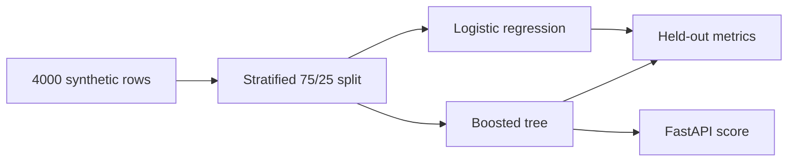

# Predictive Maintenance

[](https://github.com/Tiereonna/predictive-maintenance/actions/workflows/ci.yml)

Two tracks:

1. A small demo on **simulated** sensor rows (the FastAPI page). Live: [predictive-maintenance-8hqf.onrender.com](https://predictive-maintenance-8hqf.onrender.com). Free Render instance; first load after idle can take about 30 seconds.
2. A chunked ETL + model on **real** [Backblaze hard drive stats](https://www.backblaze.com/cloud-storage/resources/hard-drive-test-data) (cite Backblaze). Failures are rare, so the numbers drop vs the toy demo. Use those numbers on a resume, not the simulated 0.80 ROC-AUC.

The question is: will this machine fail within 7 days? Training compares logistic regression with a boosted tree and writes precision, recall, F1, and ROC-AUC. The FastAPI page scores one reading.

## Pipeline



## Setup

```bash
python3 -m venv .venv
source .venv/bin/activate
pip install -r requirements.txt
python -m pytest tests/test_generate_data.py
python src/train.py
uvicorn app:app --app-dir src --reload
```

Open `http://127.0.0.1:8000`. The form POSTs to `/api/predict`. Train first. If `artifacts/models.joblib` is missing, scoring returns an error.

On some Macs XGBoost needs OpenMP (`brew install libomp`). If that library is missing, training uses scikit-learn `HistGradientBoostingClassifier` instead. Say whichever model the script printed.

## Sample input

First rows from `generate_sensor_frame()` with the fixed seed:

```csv
hours_run,vibration_mm_s,temperature_c,pressure_psi,current_amps,failed_within_7_days
7992.2,0.445,71.36,82.6,17.34,1
3746.4,1.942,52.78,110.28,16.79,0
872.2,1.446,63.68,142.71,14.73,0
```

The table has 4,000 rows. About 43% are labeled as failing within 7 days, so accuracy alone would be a weak score.

## Sample output

Held-out test metrics from the last `python src/train.py` run on this machine. XGBoost was not installed, so the tree model is HistGradientBoosting:

```csv
model,precision,recall,f1,roc_auc
logistic,0.665,0.714,0.689,0.797
HistGradientBoosting,0.682,0.712,0.697,0.802
```

Both models land near 0.80 ROC-AUC and 71% recall. The API scores one row with the tree model and returns a failure probability. The hosted page uses whichever tree the Docker build trained (XGBoost if the image has it).

## Layout

```text
src/generate_data.py   synthetic rows and the planted failure rule
src/train.py           split, fit, metrics, save models
src/app.py             local FastAPI demo
src/etl_backblaze.py   chunked load of Backblaze daily csvs
src/train_backblaze.py time-based split (no future rows in train)
tests/
static/index.html      one-page form
Dockerfile             trains the toy model at build time
render.yaml            free Render web service
```

## Backblaze (real data)

Download a yearly zip from Backblaze, unzip some daily csvs, then:

```bash
python src/etl_backblaze.py --path data/backblaze/days
python src/train_backblaze.py
```

Last run on this machine: 16 days from 2013, 359,727 rows, 0 rejected. Train/test split by date (75/25). Failure rate about 0.02–0.04%. Empty SMART columns were dropped. Missing values were filled with the median for logistic regression.

```text
logistic                precision 0.012  recall 0.387  f1 0.024  roc_auc 0.731
HistGradientBoosting    precision 0.007  recall 0.419  f1 0.014  roc_auc 0.689
```

Logistic regression won on ROC-AUC. The tree did not. Precision is low because almost every drive is healthy.

If `DATABASE_URL` is set, the ETL upserts into `drive_daily`.

## Tests last run

```text
4 passed
```

Files under `artifacts/` are gitignored.

Those tests check the generator, plus Backblaze cleaning (bad dates / blank serials, chunked folder load).
