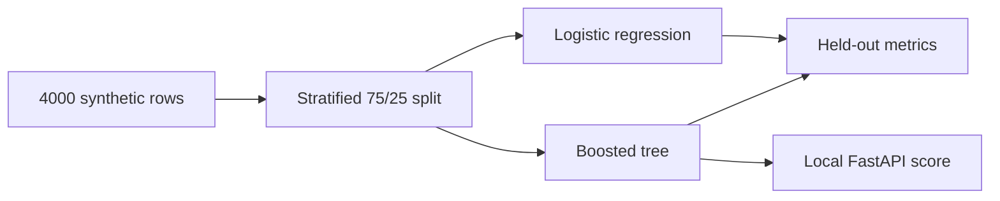

# Predictive Maintenance

[](https://github.com/Tiereonna/predictive-maintenance/actions/workflows/ci.yml)

Local demo only. The rows are simulated sensor readings, not a factory feed. Nothing is deployed.

The question is: will this machine fail within 7 days? Training compares logistic regression with a boosted tree and writes precision, recall, F1, and ROC-AUC. A small FastAPI page on your laptop can then score one reading.

## Pipeline



## Setup

```bash
python3 -m venv .venv
source .venv/bin/activate
pip install -r requirements.txt
python -m pytest tests/test_generate_data.py
python src/train.py
uvicorn app:app --app-dir src --reload
```

Open `http://127.0.0.1:8000`. The form POSTs to `/api/predict`. Train first. If `artifacts/models.joblib` is missing, scoring returns an error.

On some Macs XGBoost needs OpenMP (`brew install libomp`). If that library is missing, training uses scikit-learn `HistGradientBoostingClassifier` instead. Say whichever model the script printed.

## Sample input

First rows from `generate_sensor_frame()` with the fixed seed:

```csv
hours_run,vibration_mm_s,temperature_c,pressure_psi,current_amps,failed_within_7_days
7992.2,0.445,71.36,82.6,17.34,1
3746.4,1.942,52.78,110.28,16.79,0
872.2,1.446,63.68,142.71,14.73,0
```

The table has 4,000 rows. About 43% are labeled as failing within 7 days, so accuracy alone would be a weak score.

## Sample output

Held-out test metrics from the last `python src/train.py` run on this machine. XGBoost was not installed, so the tree model is HistGradientBoosting:

```csv
model,precision,recall,f1,roc_auc
logistic,0.665,0.714,0.689,0.797
HistGradientBoosting,0.682,0.712,0.697,0.802
```

Both models land near 0.80 ROC-AUC and 71% recall. The API scores one row with the tree model and returns a failure probability. That page is localhost only.

## Layout

```text
src/generate_data.py   synthetic rows and the planted failure rule
src/train.py           split, fit, metrics, save models
src/app.py             local FastAPI demo
tests/test_generate_data.py
static/index.html      one-page form
```

Files under `artifacts/` are gitignored.

## Tests last run

```text
tests/test_generate_data.py
2 passed
```

Those tests check that the generator returns 4,000 complete rows and that the same seed produces the same table.
